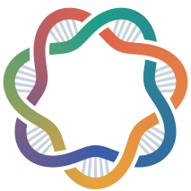

<div align="center">



# OmicsWeave

**From genomic files to model inputs — one region query away.**

[](https://github.com/CladeTeam/OmicsWeave/actions/workflows/ci.yml)
[](https://pypi.org/project/omicsweave/)
[](https://pypi.org/project/omicsweave/)
[](#installation)
[](https://github.com/CladeTeam/OmicsWeave/tree/main/crates)

[Quick start](#quick-start) · [Support matrix](#support-matrix) · [Documentation](#documentation) · [Examples](https://github.com/CladeTeam/OmicsWeave/tree/main/examples)

</div>

---

OmicsWeave is a unified Python toolkit for turning multi-omics files into training data. Ask for a genomic region and get back NumPy arrays — sequence, signal, intervals, alignments, variants or contact maps — straight from the indexed file, without unpacking the whole dataset first. A native Rust engine does the decoding, and the same engine converts formats and quantifies alignments, so data preparation, exploration and data loading all run on one set of tools.

## Highlights

- 🧬 **One query model for every omics layer.** Sequences, signal tracks, peaks, reads, genotypes, personal haplotypes and Hi-C tiles are all read by the same 0-based, half-open keys: contiguous regions, spliced transcripts, strands and 2-D contact windows.
- ⚡ **Built for data loaders.** Decoding runs in Rust and releases the GIL. Readers pickle into DataLoader workers, share an optional block cache, clone for threads and can write straight into preallocated batch buffers with `out=`.
- 🔁 **Prepare once, query forever.** `ow convert` turns text formats (BED, bedGraph, wig, bedMethyl, VCF, SAM, cool, pairs, ...) into their indexed counterparts, streaming in parallel under a memory budget.
- 📊 **Quantify in a single pass.** `ow quant` scans a sorted BAM once and produces any mix of coverage tracks, RNA / ATAC / ChIP count matrices, splice junctions, velocity layers, metabolic labeling, methylation, Hi-C contacts and allele counts.
- 🧭 **Annotation-aware.** GTF / GFF3 load into columnar tables that turn genes and transcripts into query keys (exons, CDS, UTRs) and feature sets (introns, promoters, gene bodies) for queries and quantification.
- 🎯 **Faithful to the reference tools.** Reads match what htslib returns, bigWig statistics match libBigWig, consensus sequences match `bcftools consensus`, and written files are standard: other tools read them as usual.

## Quick start

```sh
pip install omicsweave
```

```python
from omicsweave.query import SequenceReader, TrackReader, ContactReader
from omicsweave.types import Region, ContactWindow

region = Region("chr1", 1_000_000, 1_131_072)

with SequenceReader("genome.fa.gz") as genome, TrackReader("atac.bw") as atac:
    bases = genome.fetch(region).bases                    # uint8 [131072], ASCII
    signal = atac.signal(region).values                   # float32 [131072], NaN = no data
    binned = atac.bins(region, 128, ("mean", "max"))      # float32 [2, 1024]

with ContactReader("contacts.hic") as hic:
    tile = hic.matrix(ContactWindow(region, region, 2048)).values  # float32 [64, 64]
```

Transcripts come straight from the annotation:

```python
from omicsweave.annotation import Annotation

annotation = Annotation.read("genes.gtf.gz", attributes=None)
mrna_key = annotation.locus("ENST00000269305")           # a Spliced key, strand included

with SequenceReader("genome.fa.gz") as genome:
    mrna = genome.fetch(mrna_key).text                   # spliced, 5' → 3'
```

Files that are not indexed yet are converted once, and BAMs are quantified in one pass:

```sh
ow convert peaks.bed peaks.bb --chrom-sizes genome.fa.fai
ow convert cohort.vcf.gz cohort.bcf --index
ow convert contacts.mcool contacts.hic -t 8 -m 4G

ow quant cells.bam -o results --gtf genes.gtf --genes single-cell --velocity --matrix mtx
```

## Support matrix

✅ supported · ➜ convert first · — not applicable. Text inputs may be plain, gzip or BGZF compressed.

| Data | Format | Read by region | Convert from it | Convert into it | Write from Python | Index | In `ow quant` |
|---|---|:---:|---|---|---|---|---|
| **Sequence** | [FASTA](https://github.com/CladeTeam/OmicsWeave/blob/main/docs/formats/fasta.md) | ✅ bases | bgzip FASTA, 2bit | — | `FastaWriter` | `.fai` | reference |
| | [bgzip FASTA](https://github.com/CladeTeam/OmicsWeave/blob/main/docs/formats/fasta.md) | ✅ bases | bgzip FASTA, 2bit | from FASTA | `FastaWriter` | `.fai` + `.gzi` | reference |
| | [gzip FASTA](https://github.com/CladeTeam/OmicsWeave/blob/main/docs/formats/fasta.md) | ➜ | bgzip FASTA, 2bit | — | — | — | — |
| | [2bit](https://github.com/CladeTeam/OmicsWeave/blob/main/docs/formats/2bit.md) | ✅ bases, soft mask | — | from FASTA | `TwoBitWriter` | built in | reference |
| **Signal** | [bigWig](https://github.com/CladeTeam/OmicsWeave/blob/main/docs/formats/bigwig.md) | ✅ per base, bins, runs | — | from bedGraph, wig, bedMethyl | `BigWigWriter` | built in | output: coverage, methylation |
| | [bedGraph](https://github.com/CladeTeam/OmicsWeave/blob/main/docs/formats/bedgraph.md) | ➜ | bigWig, bigBed | — | — | — | — |
| | [wig](https://github.com/CladeTeam/OmicsWeave/blob/main/docs/formats/wig.md) | ➜ | bigWig | — | — | — | — |
| **Intervals** | [bigBed](https://github.com/CladeTeam/OmicsWeave/blob/main/docs/formats/bigbed.md) | ✅ overlapping records | — | from BED, bedGraph, bedMethyl | `BigBedWriter` | built in | peaks as features |
| | [BED](https://github.com/CladeTeam/OmicsWeave/blob/main/docs/formats/bed.md) | ➜ | bigBed | — | — | — | — |
| | [bedMethyl](https://github.com/CladeTeam/OmicsWeave/blob/main/docs/formats/bedmethyl.md) | ➜ | bigBed (all columns), bigWig (one column) | — | — | — | — |
| **Alignments** | [BAM](https://github.com/CladeTeam/OmicsWeave/blob/main/docs/formats/bam.md) | ✅ records, chosen fields | coordinate-sorted BAM | from SAM, CRAM, BAM | — | `.bai` / `.csi` | **input** |
| | [CRAM 3.0 / 3.1](https://github.com/CladeTeam/OmicsWeave/blob/main/docs/formats/cram.md) | ✅ records, chosen fields | BAM | — | — | `.crai` | ➜ BAM |
| | [SAM](https://github.com/CladeTeam/OmicsWeave/blob/main/docs/formats/sam.md) | ➜ | BAM | — | — | — | ➜ BAM |
| **Variants** | [BCF](https://github.com/CladeTeam/OmicsWeave/blob/main/docs/formats/bcf.md) | ✅ genotypes, INFO / FORMAT, filters, consensus | — | from VCF | — | `.csi` | known sites, allele sites |
| | [VCF](https://github.com/CladeTeam/OmicsWeave/blob/main/docs/formats/vcf.md) | ➜ | BCF | — | — | — | ➜ BCF |
| **Contacts** | [.hic v8 / v9](https://github.com/CladeTeam/OmicsWeave/blob/main/docs/formats/hic.md) | ✅ dense tiles, pixels | — | from cool, mcool, pairs, Juicer short | `HicWriter`, `HicBuilder` | built in | output |
| | [cool](https://github.com/CladeTeam/OmicsWeave/blob/main/docs/formats/cool.md) / [mcool](https://github.com/CladeTeam/OmicsWeave/blob/main/docs/formats/mcool.md) | ➜ | .hic | — | — | — | — |
| | [4DN pairs](https://github.com/CladeTeam/OmicsWeave/blob/main/docs/formats/pairs.md) | ➜ | .hic | — | — | — | output |
| | [Juicer short](https://github.com/CladeTeam/OmicsWeave/blob/main/docs/formats/juicer-short.md) | ➜ | .hic | — | — | — | — |
| **Annotation** | [GTF](https://github.com/CladeTeam/OmicsWeave/blob/main/docs/formats/gtf.md) / [GFF3](https://github.com/CladeTeam/OmicsWeave/blob/main/docs/formats/gff3.md) | ✅ loaded in memory | — | — | `write_gtf`, `write_bed12` | not needed | genes, promoters, gene activity, ... |
| **Loader metadata** | [Sidecar](https://github.com/CladeTeam/OmicsWeave/blob/main/docs/formats/sidecar.md) | — | — | — | `sidecar=True` on writers | — | — |

Indexes are never built behind your back: call `build_index()` on the format object, or pass `--index` to `ow convert`. See the [format overview](https://github.com/CladeTeam/OmicsWeave/blob/main/docs/formats/README.md) for coordinates, compression and indexes across formats.

### Query results at a glance

| Reader | Input | Returns |
|---|---|---|
| `SequenceReader` | FASTA, bgzip FASTA, 2bit | `uint8` bases (reverse complement on `-`) |
| `TrackReader` / `StrandedTrackReader` | bigWig (one, or a plus / minus pair) | `float32` per-base signal; mean / min / max / sum / std / coverage bins; stored runs |
| `IntervalReader` | bigBed | `uint32` starts / ends + the remaining BED fields |
| `AlignmentReader` | BAM, CRAM | fixed columns as arrays; names, sequences, qualities, CIGARs, tags on request |
| `VariantReader` | BCF | `int8` genotype tensor; typed INFO / FORMAT arrays; bcftools `-i` / `-e` filters |
| `ConsensusReader` | BCF + reference | personal sequences per sample, haplotype or ALT, batched; optional chain |
| `ContactReader` | .hic | `float32` contact tiles or nonzero pixels, raw counts, BP or FRAG bins |

### Quantification products

| Assay | Product | Output |
|---|---|---|
| Any | `Coverage` | bigWig, combined or per strand, optional CPM scaling |
| scRNA / bulk RNA | `Counts.rna_single_cell` / `rna_bulk` | gene × cell / sample matrices, featureCounts-style table |
| RNA velocity | `Counts(..., velocity=True)` | `spliced` / `unspliced` / `ambiguous` layers |
| Splicing | `Junctions` | STAR-style junction table, optional matrix |
| Metabolic labeling | `Labeling`, `Labeled` | conversion histograms, mismatch profiles, `labeled` layer |
| scATAC | `Atac` | fragments + index, barcode metrics, peak / tile / gene-activity matrices |
| ChIP-seq / CUT&Tag | `Counts.chip` | peak or bin counts |
| DNA methylation | `Methylation` | per-cytosine table, beta / coverage bigWig, M-bias, region matrices |
| Hi-C / Micro-C | `Contacts` | 4DN pairs, raw-count .hic, per-cell metrics |
| Allele counting | `Alleles`, `AlleleGenes` | `ref` / `alt` / `other` layers, haplotype-resolved gene counts |

Matrices are written as CellPack (`.cpk`, default), Matrix Market or CSV. OmicsWeave starts from aligned reads: it does not align, call peaks, call variants or correct barcodes.

## Installation

OmicsWeave is on PyPI and supports Python 3.12 or newer; prebuilt wheels target Linux on x86_64 and aarch64.

```sh
pip install omicsweave
# or, in a uv-managed project
uv add omicsweave
```

This installs the `omicsweave` package and the `ow` command. NumPy is the only runtime dependency; `pyarrow` is optional for Arrow string export.

## Documentation

| Guide | What it covers |
|---|---|
| [Query by region](https://github.com/CladeTeam/OmicsWeave/blob/main/docs/query.md) | keys, readers, result shapes, strands, caching, concurrency, DataLoader use |
| [Convert formats](https://github.com/CladeTeam/OmicsWeave/blob/main/docs/convert.md) | supported routes, indexes, sorting, resource budgets, dry runs |
| [Quantify alignments](https://github.com/CladeTeam/OmicsWeave/blob/main/docs/quant.md) | products, counting rules, matrix storage, assay-specific options |
| [Format guides](https://github.com/CladeTeam/OmicsWeave/blob/main/docs/formats/README.md) | every format: what it stores, how it is laid out, how OmicsWeave supports it |
| [Examples](https://github.com/CladeTeam/OmicsWeave/tree/main/examples) | PyTorch data loaders for sequence-to-function and multi-modal models |

The guides are written in Chinese.

## Package layout

| Module | Purpose |
|---|---|
| `omicsweave.types` | keys (`Region`, `Spliced`, `ContactWindow`) and result types |
| `omicsweave.formats` | one class per file format, format detection, writers, index builders |
| `omicsweave.query` | region readers; `query.open(path)` picks one by content |
| `omicsweave.cache` | `BlockCache`, decoded blocks shared across readers |
| `omicsweave.convert` | `convert.plan` / `convert.run`, also `ow convert` |
| `omicsweave.quant` | `quant.Task`, products, `quant.plan` / `quant.run`, also `ow quant` |
| `omicsweave.annotation` | GTF / GFF3 tables, lookups, overlaps, derived feature sets |
| `omicsweave.errors` | the exceptions every layer raises |
